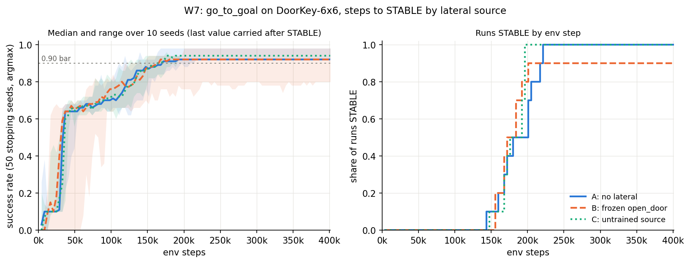

# W7 summary: does a lateral from a frozen primitive make a new primitive learn faster? (C-2)

> Run 2026-11-15, CPU (Windows), following
> [`2026-11-15_W7_pn_lateral_plan.md`](2026-11-15_W7_pn_lateral_plan.md) (revision 7) under decision
> [0013](../kb/decisions/0013-c2-lateral-source-open-door.md) (`Accepted` 2026-11-15, PR 28).
> Nothing was frozen or registered, and nothing under `src/` or outside `runs/v2/w7/` was written.

## Verdict: no measurable benefit

On this pair (`{0,3} go_to_goal` reading the frozen `{0,2} open_door`) and this metric (env steps
to STABLE under decision 0004's argmax rule), **a lateral from a trained primitive did not reduce
steps to STABLE**: B does not beat A, and A does not beat B. B does not beat C either. This is the
plan's row **"No measurable benefit"**, so PN forward transfer is not claimed on this evidence
(decisions 0003, 0006).

What the design could have seen: with arm A's measured spread, a true reduction of **25 % or
more** would have passed about 8 times in 10 (30 %: 19 in 20). "No measurable benefit" therefore
means no reduction of roughly a quarter or more; smaller effects are not excluded.

## Results

| Arm | Lateral source | STABLE | Steps to STABLE, median (range) | sd of log steps | Final score, median (range) | steps/s, median |
|---|---|---|---|---|---|---|
| A | none | 10/10 | 190,464 (143,360–221,184) | 0.143 | 0.901 (0.850–0.930) | 661 |
| B | frozen `{0,2} open_door` | 9/10 | 178,176 (155,648–401,408 censored) | 0.276 | 0.875 (0.840–0.934) | 621 |
| C | untrained network, torch seed 900000 + seed | 10/10 | 184,320 (147,456–196,608) | 0.097 | 0.919 (0.852–0.930) | 638 |

Steps to STABLE per training seed (multiples of 4,096; censored runs count at 401,408):

| Seed | A | B | C |
|---|---|---|---|
| 1000 | 180,224 | 172,032 | 196,608 |
| 1100 | 172,032 | 184,320 | 196,608 |
| 1200 | 221,184 | 401,408 (censored) | 167,936 |
| 1300 | 167,936 | 167,936 | 172,032 |
| 1400 | 143,360 | 184,320 | 196,608 |
| 1500 | 200,704 | 167,936 | 167,936 |
| 1600 | 200,704 | 155,648 | 176,128 |
| 1700 | 159,744 | 192,512 | 147,456 |
| 1800 | 204,800 | 155,648 | 192,512 |
| 1900 | 217,088 | 200,704 | 192,512 |

The criterion (plan, "Criterion"): one-sided exact Wilcoxon signed-rank on the paired differences,
zeros dropped, average ranks for ties, p = P(W⁺ ≤ observed); and the median paired ratio ≤ 0.80.

| Test | m | W⁺ | p | Median ratio | Beats? |
|---|---|---|---|---|---|
| B beats A | 9 | 21.5 | 0.469 | 0.977 | no |
| B beats C | 9 | 19.0 | 0.354 | 0.957 | no |
| A beats B | 9 | 23.5 | 0.559 | 1.024 | no |
| C beats A (reported, decides nothing) | 10 | 20.5 | 0.255 | 0.932 | no |
| C beats B (reported, decides nothing) | 9 | 26.0 | 0.660 | 1.046 | no |

*Left: success rate on the 50 stopping seeds, median and range over the ten seeds; after a run
stops at STABLE its last evaluation is carried forward. Right: share of the ten runs STABLE by
env step (the metric itself).*

- **B, seed 1200** never reached 0.90: it sat at 0.78–0.80 for the last part of the budget (best
  Wilson lower bound 0.670) and is censored at 401,408. It is the only censored run of the 30.
- **Final score** (500 fresh env seeds 60000–60499, argmax, DoorKey-6x6 under `go_to_goal`'s own
  hook; reported, not a criterion): 15 of the 30 models score below 0.90 on fresh seeds (A 5,
  B 7, C 3). The runs stop on the first two evaluations that clear 0.90 on the 50 stopping seeds,
  so a fresh-seed score just under the bar is expected; H-4's `go_to_goal` scored 0.92 held-out.
- **Lateral cost (v2 §7, F22):** B ran at 94 % and C at 96 % of A's steps/s (ten runs in parallel,
  one torch thread each; evaluation included).

## Power, recomputed from arm A

Log-normal steps to STABLE with arm A's median (190,464) and sd of log steps (0.143), the
candidate's median reduced by r, arms independent (as in the plan's own simulation), quantised to
4,096 and censored at 401,408, 4,000 simulations of ten pairs, the exact test and the ratio rule
above (`scripts/analyse_w7_lateral.py`, `power()`):

| True reduction r | 0 | 10 % | 20 % | 25 % | 30 % | 40 % |
|---|---|---|---|---|---|---|
| Pass rate | 0.001 | 0.05 | 0.47 | 0.80 | 0.96 | 1.00 |

The measured spread (0.143) is much smaller than the 35–50 % the plan assumed, so the design was
stronger than planned. Arm B's own spread is larger (0.276), almost entirely from the censored
seed 1200.

## What was run

| Step | What | Result |
|---|---|---|
| 0b | Decision PR (PR 27, rebased onto PR 26); 0013 set `Accepted` in PR 28 at Emir's instruction | Merged |
| 1 | `scripts/train_w7_lateral.py`; smoke run of each arm (16,384 steps, `eval_every` 4,096); H-4 check | All checks pass (below) |
| 2 | Arm A, seeds 1000–1900, ten runs in parallel, one torch thread each | 10/10 STABLE; gate (≥ 7/10) passes |
| 3 | Arms B and C, ten seeds each, two batches of ten | B 9/10, C 10/10 |
| 4 | `scripts/eval_w7_lateral.py` (final score), `scripts/analyse_w7_lateral.py --write` | This file |

Step-1 checks, all passed on the smoke runs (the source-hash, optimizer, `state_dict` and
lateral-change checks were repeated on every one of the 20 B and C runs, and passed):
`model.zip` saves and loads back with the same policy hash as `policy_state_dict.pt` and
`run.json` (the fallback was not needed); the source's hash is the same before the PPO object is
built, after it is built and after training (`open_door` `0382af13…`); the source has no
parameter in the target's optimizer and no key in its `state_dict`; `lat1` and `lat2` change;
B's `run.json` lists `open_door` under `children` with spec hash `93d523882d512ba6` and policy
hash; C's `run.json` config names torch seed 900000 + seed and the policy hash. B and C start
from the same target weights (identical initial lateral hash). Before scoring, each source was
rebuilt (B from the registry, C from its torch seed) and its hash checked against both records,
and each model's loaded weights against `run.json`'s `policy_sha256`.

The lateral weights are snapshotted between PPO construction and `learn()` by wrapping
`track_model` inside the script (`_Snapshot`); `train_primitive` itself is unchanged.

## Deviations

1. **Torch threads: one per run (Emir's choice after step 1).** Step 1 found that the thread
   count alone changes the result at a fixed seed: arm A at seed 42 with `eval_every` 20,000
   reproduces H-4's evaluation series exactly with torch's default (16 threads: 200,000 steps)
   but diverges from the fourth evaluation with one thread (260,000 steps). All 30 runs used one
   thread (recorded as `threads` in every result JSON). The W7 numbers are not comparable to
   H-4's anyway (plan, "Known before the run").
2. **Smoke budget** 16,384 steps (8 rollouts, 4 evaluations); the plan did not fix one.
3. **Scoring route.** Models were scored from `policy_state_dict.pt` with the rebuilt source
   (`attach_sb3_primitive_policy(lateral_source=holder)`), one of the two routes the plan allows;
   `model.zip` was shown to load in step 1.
4. **`code_commit` in `run.json`.** The runs were made on the branch before it was rebased onto
   `main` (`d072f3d` for step 2, `5164ba7` for step 3); after the rebase the same content is
   `fc47b38` and `2c27035`. Every `run.json` also carries the SHA-256 of every source file.

## Cost

Training env steps for the 30 runs: **5,656,576** (A 1,867,776; B 1,982,464; C 1,806,336), of the
plan's maximum 12,042,240. Listed separately: the H-4 check, 460,000 (two runs, 200,000 and
260,000), and the smoke runs, 49,152. Evaluation episodes are not counted. Wall time: step 2
5.5 min, step 3 15 min (two batches of ten), final score about 2 min.

## Limits

- One pair, one metric. The metric uses decision 0004's argmax rule; if W1b changes the rule to
  sampling, these numbers stay under the old rule.
- Ten seeds per arm; effects under roughly 25 % are not excluded (table above).
- Arm C's source is not a node; it exists only as a control (decision 0013).

## Files

- Plan: [`2026-11-15_W7_pn_lateral_plan.md`](2026-11-15_W7_pn_lateral_plan.md)
- Scripts: [`train_w7_lateral.py`](../../scripts/train_w7_lateral.py),
  [`eval_w7_lateral.py`](../../scripts/eval_w7_lateral.py),
  [`analyse_w7_lateral.py`](../../scripts/analyse_w7_lateral.py); tests
  [`test_w7_lateral.py`](../../tests/test_w7_lateral.py)
- Results: [`runs/v2/w7/w7_lateral.json`](../../runs/v2/w7/w7_lateral.json) (summary, tests,
  power, final scores), `runs/v2/w7/runs/<arm>_s<seed>.json` (per run, with the evaluation
  series and the run store's report), `runs/v2/w7/scores/<arm>.json` (final scores and failed
  env seeds), `runs/v2/w7/models/<arm>_s<seed>.pt` (the 30 state dicts), `runs/v2/w7/checks/`
  and `runs/v2/w7/smoke/` (step 1)
